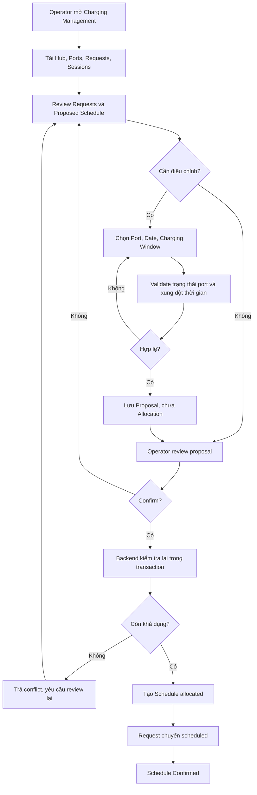

# UC08 – Manage and Schedule Charging

## 1. Mục tiêu và phạm vi

UC08 dành cho **System Operator**: theo dõi cổng sạc tại Mobility Hub, xem yêu cầu/phiên sạc, đánh giá lịch đề xuất, điều chỉnh phân bổ và xác nhận lịch.

- **Route:** `/operator/charging` (`ROUTES.OPERATOR.CHARGING`), được bảo vệ bởi role `system_operator`.
- **Page:** `src/features/charging/pages/ManageChargingPage.tsx`.
- **UI:** tái sử dụng `MainLayout`, Sidebar, Header và shared components (`Card`, `Table`, `Button`, `Select`, `Dialog`, `Banner`, `StatusBadge`, `DateTimeInput`).
- **Hiện trạng:** Frontend dùng mock data và React local state; chưa tích hợp API hoặc thuật toán lập lịch thực tế.

## 2. Tổng quan màn hình

| Màn hình | Cơ chế chính |
|---|---|
| **Charging Management Overview** | Tổng hợp cổng Available / Occupied / Unavailable theo Hub; xem chi tiết port; xem request đang chờ. |
| **Charging Requests and Sessions** | Phân biệt request chờ lập lịch/lập lịch lại với các session đang sạc; chọn request để review. |
| **Proposed Charging Schedule** | Xem request, Hub, khung giờ mong muốn, port/window đề xuất và trạng thái proposal. |
| **Adjust Charging Schedule** | Chọn port, date và charging window khác; validate trước khi lưu. |
| **Schedule Confirmed** | Hiển thị allocation được xác nhận và resource state sau xác nhận. |
| **Insufficient Charging Ports** | Minh họa nhu cầu vượt số cổng khả dụng trong một time window và phương án thay thế. |
| **Charging Port Unavailable** | Minh họa proposal bị ảnh hưởng do port lỗi và phương án phân bổ lại. |
| **Charging Demand Changed** | So sánh proposal trước/sau khi nhu cầu thay đổi; yêu cầu review lại. |
| **Priority Review** | Hiển thị request cần operator chú ý do pin thấp hoặc nhu cầu sử dụng gần. |

Các màn hình Proposed Schedule – Adjusted / Alternative / Reallocated / Demand Updated dùng chung trang Proposed Charging Schedule, với dữ liệu và thông báo theo từng scenario.

## 3. Luồng nghiệp vụ



**Phân biệt trạng thái:** Proposal là phương án dự kiến; `allocated` là lịch đã được operator xác nhận; `charging` là phiên sạc thực tế đang diễn ra. Lưu điều chỉnh không xác nhận lịch và xác nhận lịch không tự khởi động phiên sạc.

## 4. Domain và quy tắc dữ liệu

UC08 dùng các type có sẵn trong `src/types/domain.ts`, không tạo domain riêng:

- `MobilityHub` – Hub sở hữu nhiều port.
- `ChargingPort` – cổng sạc và trạng thái vật lý `idle | charging | out_of_service`.
- `ChargingRequest` – yêu cầu sạc, Hub, requested window, battery, needed-by và request status.
- `ChargingScheduleProposal` – port/window được đề xuất, trạng thái `proposed | outdated`.
- `ChargingSchedule` – allocation/session, trạng thái `allocated | charging | completed | cancelled | disrupted`.

Các kiểm tra chính khi điều chỉnh/xác nhận:

1. Port phải thuộc cùng Hub với request và đang `idle`.
2. `endAt` phải sau `startAt`.
3. Không trùng proposal khác hoặc schedule `allocated`/`charging` trên cùng port và time window.
4. Backend phải kiểm tra lại tại thời điểm confirm vì port/demand có thể đã thay đổi sau lúc proposal được hiển thị.
5. Trạng thái vật lý `ChargingPort.physicalState` độc lập với trạng thái kế hoạch `ChargingSchedule.status`. Allocation không làm port chuyển sang `charging`; trạng thái phiên thực tế nên được đồng bộ từ charger/telemetry.
6. Lưu thời gian dạng ISO-8601 UTC; hiển thị theo múi giờ `Asia/Ho_Chi_Minh`.

**Priority Review hiện tại:** hiển thị `Low battery` nếu `batteryPercent <= 20`, hoặc `Near-term usage need` nếu `neededByAt` trong vòng một giờ sau `requestedStartAt`. Đây là lý do để operator xem xét, không phải điểm số hay cơ chế tự động ưu tiên.

## 5. Mock Data

Mock data được mở rộng ngay trong `src/data/mock/seed.ts`, dùng `MockDatabase` và domain types chung; không có file mock riêng cho UC08.

- **Hub A:** CP-01, CP-02 `idle`; CP-03, CP-04 `out_of_service`.
- **Hub B:** B-01, B-02, B-03 `charging`; B-04 `out_of_service`.
- **Hub C:** CP-01 `out_of_service` (record liên quan UC10).
- **Requests UC08:** `CR-2026-001` đến `CR-2026-003`.
- **Active sessions:** `CS-101` đến `CS-103`, liên kết request `CR-SESSION-101` đến `CR-SESSION-103`.
- **Proposals:** `CSP-2026-001` và `CSP-2026-002`; `CSP-01` và `CS-01` được giữ lại để không phá vỡ dữ liệu UC06/UC10.
- Ngày demo UC08 cố định **30/10/2026**, múi giờ dự án UTC+7; các dữ liệu khác trong seed vẫn có thể dựa trên tham số `now`.

`createMockSeed(now)` tạo snapshot `MockDatabase`. Lưu ý: UC08 hiện gọi trực tiếp `createMockSeed()` và cập nhật state bằng `useState`; thay đổi chỉ tồn tại trong phiên demo, reload trang sẽ khôi phục seed. Project có `mockDataSource.loadInitialSnapshot()` nhưng page UC08 hiện chưa dùng abstraction này.

## 6. Tích hợp Backend (đề xuất)

> Các endpoint dưới đây là **API contract đề xuất**, chưa tồn tại trong source Frontend hiện tại; nhóm có thể điều chỉnh theo convention của Backend.

| Method / Endpoint | Mục đích |
|---|---|
| `GET /api/operator/charging/overview` | Lấy Hub, port summary, requests cần xử lý và active sessions. |
| `GET /api/operator/charging/requests` | Lấy/lọc charging requests theo Hub và status. |
| `GET /api/operator/charging/schedule-proposals` | Lấy proposal hiện tại. |
| `POST /api/operator/charging/schedule-proposals/generate` | Backend tạo proposal từ requests, port capacity và time windows. |
| `PATCH /api/operator/charging/schedule-proposals/{id}` | Lưu thay đổi port/date/window do operator chọn. |
| `POST /api/operator/charging/schedules/confirm` | Revalidate proposal và xác nhận allocation. |
| `POST /api/operator/charging/schedule-proposals/recalculate` | Tạo lại proposal khi demand hoặc port state thay đổi. |

**Backend chịu trách nhiệm:**

- Là nguồn dữ liệu chính cho Hub, port, request, proposal và session.
- Chạy scheduling logic theo request window, port availability, capacity, schedule/session đã tồn tại và tiêu chí ưu tiên do nhóm thống nhất.
- Khi confirm, dùng transaction: kiểm tra lại port/window/request, phát hiện conflict, tạo `ChargingSchedule(status=allocated)` và cập nhật `ChargingRequest(status=scheduled)` nguyên tử.
- Nếu port unavailable, demand changed hoặc lịch bị conflict: không confirm; đánh dấu proposal cũ `outdated`, trả trạng thái mới và proposal cần operator review.
- Phân quyền API cho `system_operator`; đồng bộ session `charging/completed` từ quy trình vận hành hoặc telemetry.

**Frontend cần thay đổi:** tạo service/hook (ví dụ `chargingService`) để thay các thao tác `createMockSeed()` / `setDatabase()` bằng API query và mutation. Sau khi save/confirm, lấy lại snapshot từ Backend; xử lý `409 Conflict` (port unavailable, overlap, capacity changed, proposal outdated), cùng loading/empty/error/retry states. Giữ domain types nếu response tương thích; nếu không, dùng DTO + mapper.

## 7. Preview và checklist kiểm thử

Preview scenario bằng query parameter:

```text
/operator/charging
/operator/charging?uc08Scenario=adjusted
/operator/charging?uc08Scenario=insufficient
/operator/charging?uc08Scenario=portUnavailable
/operator/charging?uc08Scenario=demandChanged
```

Đây là dữ liệu minh họa Frontend, không phải event thực từ Backend/charger.

Checklist: kiểm tra request/session được tách riêng; điều chỉnh đúng/sai; port khác Hub; port unavailable; time overlap; confirm và request chuyển `scheduled`; xác nhận session chưa tự chuyển `charging`; thử thiếu port, demand changed và Priority Review.
